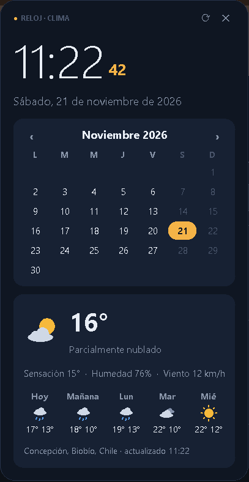

# Widget Reloj · Clima

Gadget de escritorio para Windows hecho en Python: **reloj**, **calendario** y **clima en tiempo real**, en una ventana sin bordes que queda siempre visible sobre las demás.



## Características

- 🕒 **Reloj** grande con segundos y la fecha completa en español.
- 📅 **Calendario** del mes (semana de lunes a domingo) con el día de hoy resaltado. Usa `‹` `›` para cambiar de mes y haz clic en el título para volver a hoy.
- 🌤️ **Clima actual**: temperatura, sensación térmica, humedad, viento y un icono según el estado del cielo (de día o de noche).
- 📆 **Pronóstico de 5 días** con máximas y mínimas.
- 🔄 Se actualiza solo cada 20 minutos. Si no hay conexión, lo reintenta a los 2 minutos.
- 🪟 **Ventana tipo gadget**: sin bordes, con esquinas redondeadas y siempre visible. Se arrastra desde cualquier parte o se manda a una de las **4 esquinas**, y **recuerda su posición**.
- 🌎 **Cualquier ciudad**: por defecto muestra Concepción (Chile), y se puede cambiar desde el menú.

El clima viene de [Open-Meteo](https://open-meteo.com/), un servicio **gratuito que no necesita registro ni clave de API**.

## Requisitos

- Windows 10 u 11.
- Python 3.10 o superior (probado con Python 3.14).

## Instalación

```powershell
git clone https://github.com/MiguelTapiaUrrutia/widget-reloj-clima.git
cd widget-reloj-clima
py -m venv .venv
.\.venv\Scripts\python.exe -m pip install -r requirements.txt
```

## Uso

```powershell
.\.venv\Scripts\pythonw.exe -m widget_reloj_clima
```

`pythonw` abre el widget sin una ventana de consola. Si usas `python` en su lugar, verás los mensajes en la consola.

Para abrirlo con doble clic, puedes crear un acceso directo con este destino:

```
<carpeta del proyecto>\.venv\Scripts\pythonw.exe <carpeta del proyecto>\iniciar.pyw
```

### Controles

| Acción | Cómo |
|---|---|
| Mover el widget a cualquier lugar | Arrastrarlo desde cualquier parte, excepto los botones |
| Colocarlo en una esquina | **Clic derecho → Mover a la esquina**. Elige una de las 4; respeta la barra de tareas |
| Actualizar el clima | Botón `⟳` |
| Cerrar | Botón `✕` |
| Cambiar ciudad, activar o desactivar "Siempre visible" | **Clic derecho** en cualquier parte del widget |

### Arrancar con Windows (opcional)

Pulsa `Win + R`, escribe `shell:startup` y pega en esa carpeta el acceso directo del paso anterior.

## Configuración

Los ajustes (ciudad, posición y "siempre visible") se guardan en:

```
%APPDATA%\widget-reloj-clima\config.json
```

En esa misma carpeta se escribe un registro de errores, `widget.log`. Si borras `config.json`, el widget vuelve a los valores por defecto.

## Estructura del proyecto

```
widget_reloj_clima/
├── app.py       # Ventana principal: gadget sin bordes, arrastre, menú y actualización
├── views.py     # Secciones visuales: reloj, calendario y clima
├── icons.py     # Iconos del clima dibujados con formas (sin imágenes externas)
├── placement.py # Posición en pantalla: esquinas, área de trabajo y varios monitores
├── weather.py   # Cliente de Open-Meteo: pronóstico y búsqueda de ciudades
├── config.py    # Carga y guardado de ajustes, con validación
├── dates.py     # Fechas en español, independientes del idioma del sistema
└── theme.py     # Colores y tipografía
tests/           # Tests con pytest
```

Las peticiones a internet se hacen en un hilo aparte, así que la ventana no se congela mientras espera la respuesta.

## Desarrollo

```powershell
.\.venv\Scripts\python.exe -m pip install -r requirements-dev.txt
.\.venv\Scripts\python.exe -m pytest --cov=widget_reloj_clima --cov-report=term-missing
```

Los tests de interfaz crean ventanas reales de Tk, así que necesitan un escritorio.

## Licencia

[MIT](LICENSE). Datos meteorológicos de [Open-Meteo](https://open-meteo.com/) bajo licencia CC BY 4.0.
