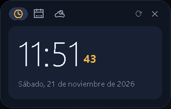
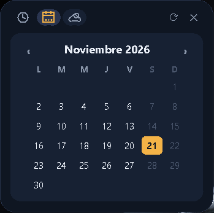
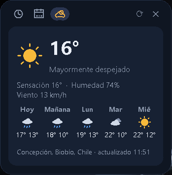
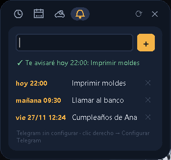

# Widget Reloj · Clima

Gadget de escritorio para Windows hecho en Python: **reloj**, **calendario**, **clima en tiempo real** y **recordatorios con aviso en el escritorio**, en una ventana compacta sin bordes que queda siempre visible sobre las demás.

> **Versión 1.0.** Los avisos al teléfono por **Telegram** ya están en el código, pero aún no se han probado con un bot real. Llegarán oficialmente en la **versión 2**. Mira [Próxima versión: avisos en Telegram](#próxima-versión-avisos-en-telegram).

| Reloj (vista inicial) | Mes | Clima | Avisos |
|---|---|---|---|
|  |  |  |  |

## Características

- 🧭 **Cuatro vistas en una ventana pequeña**: los iconos de arriba cambian entre reloj, mes, clima y avisos. La ventana se adapta al alto de cada vista y, si está pegada abajo, crece hacia arriba para no salirse de la pantalla.
- 🕒 **Reloj** grande con segundos y la fecha completa en español.
- 📅 **Calendario** del mes (semana de lunes a domingo) con el día de hoy resaltado. Usa `‹` `›` para cambiar de mes y haz clic en el título para volver a hoy.
- 🌤️ **Clima actual**: temperatura, sensación térmica, humedad, viento y un icono según el estado del cielo (de día o de noche).
- 📆 **Pronóstico de 5 días** con máximas y mínimas.
- 🔔 **Recordatorios en lenguaje natural**: escribes «hoy a las 22 imprimir moldes» y te avisa a esa hora con una ventana y un sonido en el escritorio. En la versión 2 también llegarán al teléfono por **Telegram**.
- 🔄 El clima se actualiza solo cada 20 minutos. Si no hay conexión, lo reintenta a los 2 minutos.
- 🪟 **Ventana tipo gadget**: sin bordes, con esquinas redondeadas y siempre visible. Se arrastra desde cualquier parte o se manda a una de las **4 esquinas**, y **recuerda su posición**. Funciona bien con varios monitores de distinta escala.
- 🌎 **Cualquier ciudad**: por defecto muestra Concepción (Chile), y se puede cambiar desde el menú.

El clima viene de [Open-Meteo](https://open-meteo.com/), un servicio **gratuito que no necesita registro ni clave de API**.

## Requisitos

- Windows 10 u 11.
- Python 3.10 o superior (probado con Python 3.14).

## Instalación

```powershell
git clone https://github.com/MiguelTapiaUrrutia/widget-reloj-clima.git
cd widget-reloj-clima
py -m venv .venv
.\.venv\Scripts\python.exe -m pip install -r requirements.txt
```

## Uso

```powershell
.\.venv\Scripts\pythonw.exe -m widget_reloj_clima
```

`pythonw` abre el widget sin una ventana de consola. Si usas `python` en su lugar, verás los mensajes en la consola.

Para abrirlo con doble clic, puedes crear un acceso directo con este destino:

```
<carpeta del proyecto>\.venv\Scripts\pythonw.exe <carpeta del proyecto>\iniciar.pyw
```

### Controles

| Acción | Cómo |
|---|---|
| Cambiar de vista | Iconos de arriba a la izquierda: reloj, mes, clima y avisos (🔔) |
| Mover el widget a cualquier lugar | Arrastrarlo desde cualquier parte, excepto los iconos, botones y el campo de texto |
| Colocarlo en una esquina | **Clic derecho → Mover a la esquina**. Elige una de las 4; respeta la barra de tareas |
| Actualizar el clima | Botón `⟳` |
| Cerrar | Botón `✕` |
| Cambiar ciudad, "Siempre visible", configurar Telegram | **Clic derecho** en cualquier parte del widget |

### Arrancar con Windows (opcional)

Pulsa `Win + R`, escribe `shell:startup` y pega en esa carpeta el acceso directo del paso anterior.

## Recordatorios

En la pestaña 🔔 escribe **cuándo y qué**, y pulsa Enter:

| Escribes | Te avisa |
|---|---|
| `hoy a las 22 imprimir moldes` | hoy a las 22:00 |
| `mañana 9:30 llamar al banco` | mañana a las 09:30 |
| `a las 7 de la tarde sacar la basura` | hoy a las 19:00 |
| `en 20 minutos sacar el pan` · `en 2 horas y media` | dentro de ese tiempo |
| `el viernes a las 18 cumpleaños de Ana` | el próximo viernes a las 18:00 |
| `25/12 a las 10 llamar a la familia` · `el 3 de marzo a las 8:30` | ese día |
| `esta noche ver la película` | hoy a las 21:00 |

Si escribes «a las 9» y ya pasaron las 9 de la mañana, entiende las 21:00. Si una hora sin día ya pasó, lo programa para mañana.

Cuando llega la hora aparece un aviso con sonido, con los botones **Posponer 10 min** y **Listo**. Si el computador estaba apagado a esa hora, el aviso aparece al abrir el widget, marcado como «Era para…».

> Los avisos solo salen mientras el widget está abierto, porque se ejecuta en tu computador.

## Próxima versión: avisos en Telegram

> 🚧 **En preparación para la versión 2.** El código ya está incluido y probado con tests automáticos, pero falta probarlo de punta a punta con un bot real. Puede cambiar antes de su lanzamiento oficial.

Cómo funcionará:

1. En Telegram, abre **@BotFather**, envía `/newbot` y sigue los pasos. Te dará un **token**.
2. En el widget: **clic derecho → Configurar Telegram…** y pega el token.
3. La pestaña 🔔 mostrará un código: envía `/vincular <código>` a tu bot.

Desde ese momento, cada aviso te llega también al teléfono, y puedes escribirle al bot:

- Cualquier recordatorio, por ejemplo `mañana 8:00 sacar la basura`.
- `/lista` para ver los pendientes y `/borrar N` para borrar uno.

**Seguridad**
- El token se guarda en el **Administrador de credenciales de Windows**. Nunca se escribe en archivos del proyecto ni en `config.json`.
- El bot solo responde al chat vinculado. Tras 5 códigos incorrectos, la vinculación se bloquea 15 minutos y después se genera un código nuevo.
- Si al encender el PC todavía no hay internet, el bot se reconecta solo. Los avisos que no se pudieron enviar al teléfono se reintentan cada minuto.
- Para dejar de usarlo: **clic derecho → Desvincular Telegram**. Borra el token y olvida el chat.
- La variable de entorno `TELEGRAM_BOT_TOKEN`, si existe, tiene prioridad sobre el token guardado (pensado para ejecutarlo en un servidor).

## Historial de versiones

- **1.0.0**: reloj, calendario, clima de 5 días y recordatorios con aviso en el escritorio. Incluye una versión preliminar de los avisos por Telegram.
- **2.0.0** (próximamente): avisos y recordatorios por Telegram probados y listos para usar.

## Configuración

Los ajustes (ciudad, posición, "siempre visible" y el chat de Telegram vinculado) se guardan en:

```
%APPDATA%\widget-reloj-clima\config.json
```

Los recordatorios se guardan en `reminders.json` y el registro de errores en `widget.log`, en esa misma carpeta. Si borras `config.json`, el widget vuelve a los valores por defecto.

## Estructura del proyecto

```
widget_reloj_clima/
├── app.py                  # Ventana principal: gadget sin bordes, pestañas, arrastre y menú
├── views.py                # Vistas de reloj, calendario y clima, y la barra de iconos
├── reminders_view.py       # Pestaña de recordatorios
├── reminders_controller.py # Une la pestaña con el servicio: alta, borrado y avisos
├── reminder_service.py     # Recordatorios + bot de Telegram, independiente de la interfaz
├── reminder_parser.py      # Interpreta «hoy a las 22 imprimir moldes»
├── reminders.py            # Almacén de recordatorios en JSON, seguro entre hilos
├── telegram_bot.py         # Cliente de la Bot API y bot privado (vinculación y comandos)
├── secrets_store.py        # Token en el Administrador de credenciales de Windows
├── alerts.py               # Ventana de aviso y diálogo de configuración de Telegram
├── icons.py                # Iconos dibujados con formas (sin imágenes externas)
├── placement.py            # Posición en pantalla: esquinas, área de trabajo y varios monitores
├── weather.py              # Cliente de Open-Meteo: pronóstico y búsqueda de ciudades
├── config.py               # Carga y guardado de ajustes, con validación
├── dates.py                # Fechas en español, independientes del idioma del sistema
└── theme.py                # Colores y tipografía
tests/                      # Tests con pytest
```

Las peticiones a internet (clima y Telegram) se hacen en hilos aparte, así que la ventana no se congela mientras espera.

## Desarrollo

```powershell
.\.venv\Scripts\python.exe -m pip install -r requirements-dev.txt
.\.venv\Scripts\python.exe -m pytest --cov=widget_reloj_clima --cov-report=term-missing
```

Los tests de interfaz crean ventanas reales de Tk, así que necesitan un escritorio. Los de Telegram usan un cliente falso: nunca se conectan a la red ni leen tu token.

## Licencia

[MIT](LICENSE). Datos meteorológicos de [Open-Meteo](https://open-meteo.com/) bajo licencia CC BY 4.0.
